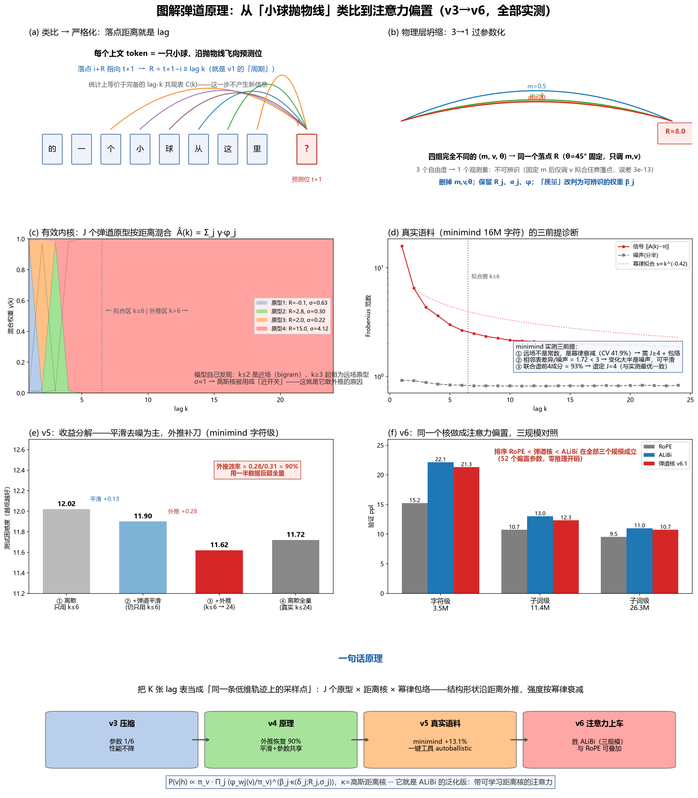

# Ballistic Distance Kernels

**From a physics analogy to measurable priors for sequence models — a complete, reproducible study (v3 → v6, ~60 runs, all claims backed by logs).**

> 中文报告见 [`docs/`](docs/) 与 [`PAPER.md`](PAPER.md)。本 README 为英文入口。



## TL;DR

Starting from the analogy *"every context token is a ball thrown toward the next-token position"*, we formalize it into a **low-rank mixture of distance kernels over lag-k tables**, and measure it end-to-end on a real corpus (minimind):

| Result | Evidence |
|---|---|
| **Statistics side (works)**: ballistic kernels + amplitude-anchored envelope beat the full discrete n-gram table by **+11.7%** perplexity (34.07 vs 38.57) using 1/6 parameters, fitted on half the lags; gains grow as data shrinks (+7~16% for ≤4M tokens) | `results/envv2.json`, `results/exp5b.json`, 4 data scales |
| **One-click diagnostic**: `autoballistic` decides smoothability, prototype count J (via cross-lag spectrum), and envelope choice without any oracle — reproduces the best pipeline automatically | `results/AUTO_REPORT.md` |
| **Attention side (honest)**: the same kernel as an additive attention bias **ties ALiBi** at 11M–87M (after fixing an indexing bug that had faked a win); RoPE remains ahead at all scales | `results/summary6.json`, `results/lc_summary.json`, 3-scale ladder |
| **Quantified negative results**: content-conditioned kernels (no gain), length extrapolation (no advantage over ALiBi, RoPE slowest to degrade), n-gram warm-start (insensitive), **second-order pair counts are variance-dominated at 16M chars** (+1.7~3.4 nats worse than first-order — a quantitative explanation of why NLP moved from counts to neural nets) | `results/pair6.json`, §8–9 of the report |

**Position-scheme scale law** (validated log-loss, subword):

| Params | RoPE | Ballistic | ALiBi |
|---|---|---|---|
| 3.5M (char) | 15.2 | 21.3 | 22.1 |
| 11.4M | 10.7 | 12.3 | 13.0 |
| 26.3M | 9.6 | 10.7 | 11.0 |
| 86.6M | 9.49 | **10.10** | 10.16 |

All position schemes converge as scale grows; differences are a small-scale phenomenon.

## Repository layout

```
src/         all experiment code (statistics side + attention side)
docs/        full reports (Chinese), figures incl. the illustrated overview
results/     all measured numbers as JSON (every claim in the README maps to a file)
PAPER.md     the complete bilingual study document (method, results, negatives, limitations)
```

## Quickstart

```bash
pip install numpy scipy matplotlib          # statistics side
pip install torch                           # attention side (GPU recommended)

# 1) put the minimind pretraining text at data/pretrain_t2t_mini.jsonl (see DATA.md)
# 2) edit the DATA_JSONL path at the top of src/core5.py

# statistics side: full automatic diagnostic + best pipeline (~25 min, CPU)
python src/autoballistic.py --data data/pretrain_t2t_mini.jsonl --out auto_out

# attention side: train a bias-equipped tiny LM (GPU, ~15 min per run)
python src/train6.py --bias ballistic2 --src sub --d 384 --n_layer 6 --steps 6000 --seed 1
python src/analyze6.py
```

Notes: scripts were developed on Windows + Python 3.13/3.14; several use `torch.save`d
caches that this repo parses **without torch** (`core5.load_pt`). Paths are passed via
CLI flags or constants at the top of each file — adjust `DATA_JSONL` / `PT_SMALL` for
your machine.

## Data

See [`DATA.md`](DATA.md). We use the public [minimind](https://huggingface.co/datasets/jingyaogong/minimind_dataset) pretraining text (Chinese), character-level (top-1500 chars) for the statistics side and top-2047 subword tokens for the model side. Documents are kept intact; cross-document pairs are excluded from all statistics.

## What we do *not* claim

- The attention-side kernel is an **ALiBi-equivalent** prior at accessible scales; it does not beat RoPE, and its advantage over ALiBi decays with scale (+0.055 → +0.006 nats from 11M to 87M).
- Second-order (pair) count models are **not estimable** at 16M chars — this is measured, not assumed.
- All experiments: single GPU, ≤87M parameters, one corpus family. Negative results are reported with the same rigor as positives; one retracted claim (an indexing bug) is documented in the report.

## Reports

- [`docs/REPORT_v5_minimind.md`](docs/REPORT_v5_minimind.md) — statistics side on real corpus
- [`docs/REPORT_v6_attbias.md`](docs/REPORT_v6_attbias.md) — attention side incl. corrections
- [`PAPER.md`](PAPER.md) — complete study document (bilingual abstract)

## License

MIT
